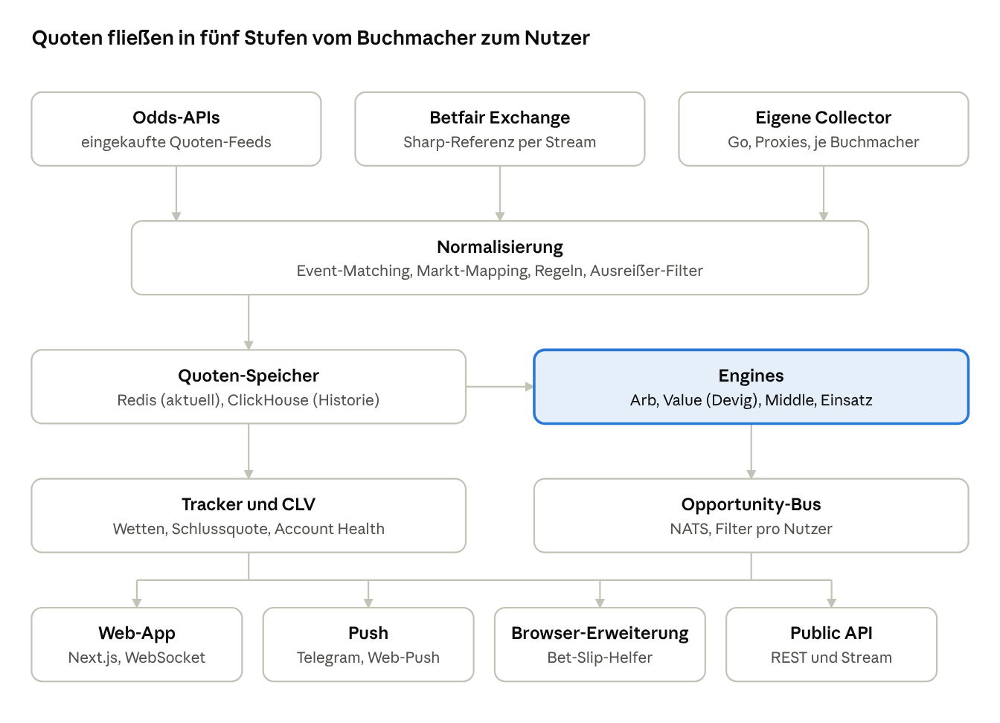
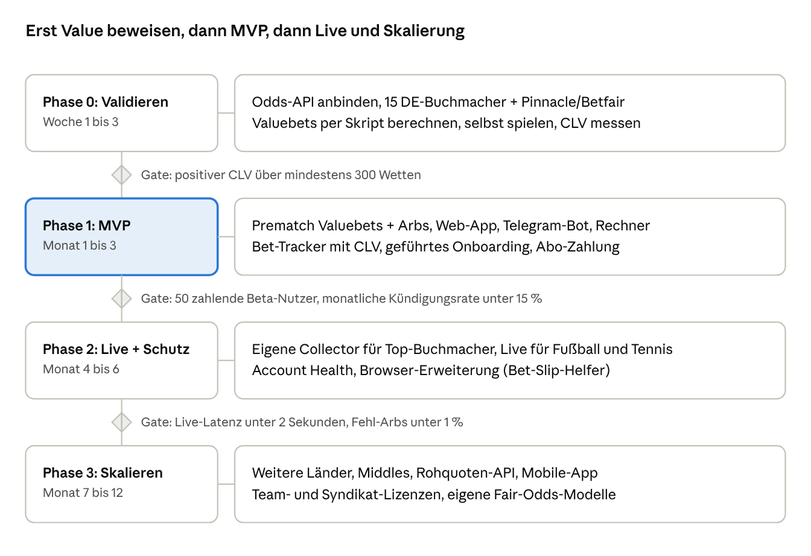

# Betburger-Analyse und Konzept für einen besseren Nachbau

Stand: 9. November 2026 · Autor: Arian (mit Claude)
Live-Version mit Kommentaren: https://claude.ai/artifact/MZwnuCqTiJhgCo9btfQJmq

## Kurzfassung

Betburger ist im Kern eine Daten-Pipeline: Quoten von rund 160 Buchmachern (plus ca. 600 Klonen) werden laufend eingesammelt, Events und Märkte werden einander zugeordnet, und daraus werden Surebets, Valuebets und Middles berechnet. Die Weboberfläche ist nur das Schaufenster. Wer das nachbaut, gewinnt oder verliert über **Datenabdeckung, Geschwindigkeit und saubere Zuordnung**, nicht über das Design.

Preislich liegt Betburger bei 79,99 € (Prematch), 279,99 € (Live) und 319,99 € (beides) für 30 Tage. Das ist teuer, die Filter gelten als kompliziert, und das größte Problem der Nutzer löst das Produkt nicht: Buchmacher limitieren Arber nach kurzer Zeit.

**Die Idee für den besseren Nachbau:** klein und schnell starten (EU-/DACH-Buchmacher, Sharps wie Pinnacle, Börsen wie Betfair), Valuebets mit sauberer Fair-Odds-Berechnung und CLV-Nachweis in den Mittelpunkt stellen, Konten-Langlebigkeit aktiv managen und eingebautes Bankroll-Tracking liefern. Kurz: nicht der hundertste Arb-Scanner, sondern ein ehrliches "Profi-Cockpit" für Value-Wetten.

Hinweis: Den eingeloggten Bereich konnte ich noch nicht ansehen, weil die Chrome-Erweiterung nicht verbunden war. Die Analyse stützt sich auf die öffentlichen Betburger-Seiten (Startseite, Preise, API, FAQ, Buchmacherliste), einen Vergleichstest und Branchenwissen.

## Feature-Analyse von Betburger

Betburger verkauft drei Wett-Typen in zwei Geschwindigkeiten (Prematch und Live) und hängt daran Rechner, Bet-Tracking, Telegram-Bot und eine API.

| Bereich | Was Betburger bietet | Bewertung |
| --- | --- | --- |
| Surebets (Arbs) | Gegenläufige Quoten bei mehreren Buchmachern, garantierter Gewinn; Prematch und Live getrennt | Kernprodukt, aber Margen meist 1 bis 3 % und schnelles Limit-Risiko |
| Valuebets | Quoten über dem "fairen" Preis, abgeleitet aus einer Durchschnitts- bzw. Sharp-Linie ("Avgline") | Langfristig profitabler und unauffälliger als Arbs; Fair-Odds-Methode intransparent |
| Middles | Zwei Wetten mit Lücke (z. B. Over 2,5 / Under 3,5), bei der beide gewinnen können | Nischen-Feature, im Prematch-Plan enthalten |
| Abdeckung | Laut Preisseite 600+ Buchmacher, 40 Sportarten + 27 E-Sports, 220+ Märkte; die Buchmacherseite nennt 160 Prematch-Buchmacher + 608 Klone | Zahlen widersprechen sich je nach Seite; enthält viele Krypto-Casinos und Prognosemärkte (Polymarket, Kalshi) |
| Filter | Sportart, Markt, Buchmacher, Land, Turnier, Startzeit, ROI, Ausschlüsse einzelner Wetten, Sortierung | Sehr mächtig, laut Tests aber kompliziert einzurichten |
| Direkt-Links | Ein Klick führt zum Event beim Buchmacher | Spart Zeit, Platzierung bleibt manuell |
| Rechner | 11 Stück: Surebet, EV, No-Vig, Kelly, Dutching, Hedge, Parlay, Round Robin, Matched Betting u. a. | Gutes SEO-Instrument, leicht nachzubauen |
| Bet-Tracking | Wetten erfassen, Gewinn auswerten | Basisfunktion, kein CLV-Fokus erkennbar |
| Telegram-Bot | Benachrichtigungen (nur im Prematch-Plan gelistet) | Push ist für Prematch sinnvoll |
| API | JSON-Feed für Prematch und Live Surebets/Valuebets; bis 30 Ergebnisse pro Anfrage, 1.800 pro Minute; 65+ Buchmacher (230+ mit Klonen); nur für zahlende Abonnenten | Liefert Ergebnisse, keine Rohquoten; Auto-Platzierung muss man selbst bauen |
| Kostenlos | Free-Plan mit Verzögerung, Surebets nur bis 1 %, Valuebets bis 2 % | Klassischer Freemium-Trichter |

**Preise (30 Tage):** Prematch 79,99 €, Live 279,99 €, Prematch + Live 319,99 €. Längere Laufzeiten senken den Tagespreis von 5,99 € (1 Tag) auf 1,94 € (360 Tage). Ein 7-Tage-Test für beides kostet 97,49 €. Zur Zeit des Abrufs stand auf der Preisseite ein Hinweis, dass Zahlungen vorübergehend nicht möglich sind.

**Positionierung:** Seit 2013 am Markt (Betreiber Aspira Limited), 15+ Sprachen, Affiliate-Programm, starkes SEO über Rechner und Vergleichsseiten. In Tests wird vor allem die Live-Geschwindigkeit gelobt.

## Schwächen und Angriffsflächen

Die größte Lücke ist, dass Betburger Wetten findet, aber nicht hilft, damit dauerhaft Geld zu verdienen.

1. **Kontolimits werden ignoriert.** Arber werden von Soft-Buchmachern nach Wochen limitiert. Das Tool zeigt Chancen, schützt aber keine Konten (kein Tarnungs-Score, keine Stake-Rundung, kein Mix mit "normalen" Wetten).
2. **Preis für Live.** 279,99 € im Monat schreckt Einsteiger ab. Dazwischen gibt es keine Stufe, z. B. "Live nur für Fußball" oder "nur meine 10 Buchmacher".
3. **Komplexität.** Viele Filter, wenig Führung. Neue Nutzer müssen erst lernen, welche Buchmacher und Märkte sich lohnen.
4. **Datenqualität ist eine Blackbox.** Die FAQ hat eigene Einträge zu "falschen Quoten" und "instabilem Service". Wie alt eine Quote ist, sieht der Nutzer nicht genau.
5. **Valuebet-Methode intransparent.** Wie der faire Preis entsteht (welche Sharps, welche Devig-Methode), ist nicht offengelegt. Ohne CLV-Auswertung kann der Nutzer nicht prüfen, ob die Valuebets wirklich Value haben.
6. **Abdeckung mit viel Ballast.** Hunderte Klone und Krypto-Casinos blähen die Zahl auf. Für einen deutschen Nutzer zählen vielleicht 15 bis 25 Buchmacher.
7. **Inkonsistente Kommunikation.** Je nach Seite 60+, 160, 400 oder 600+ Buchmacher und 30+ oder 40 Sportarten. Das kostet Vertrauen.
8. **API ohne Rohquoten.** Wer eigene Modelle bauen will, bekommt nur fertige Ergebnisse, keinen Odds-Feed.

## Wie ein Arb-Scanner technisch funktioniert

Die Mathematik ist einfach; schwer sind Event-Matching, Markt-Regeln und Latenz.

**Surebet:** Bei den besten Quoten o₁ … oₙ aller Ausgänge eines Marktes liegt eine Surebet vor, wenn die Summe der Kehrwerte unter 1 liegt. Der Einsatz pro Ausgang verteilt das Budget B proportional:

```
S = Σ 1/o_i < 1        s_i = B · (1/o_i) / S        Gewinn = B · (1/S − 1)
```

**Valuebet:** Aus der Quote eines Sharp-Buchmachers (Pinnacle, Betfair-Börse) wird die Marge herausgerechnet ("Devig"), das ergibt die faire Wahrscheinlichkeit p. Eine Quote o bei einem anderen Buchmacher ist Value, wenn der Erwartungswert positiv ist:

```
p_i = (1/o_i_sharp) / Σ_j (1/o_j_sharp)        EV = p_i · o − 1 > 0
```

Die einfache Normierung oben ist die multiplikative Methode. Besser sind Power-, Shin- oder Worst-Case-Methoden, weil Buchmacher die Marge nicht gleichmäßig verteilen (Favoriten-Außenseiter-Effekt). Als Einsatzgröße dient meist ein Bruchteil des Kelly-Kriteriums.

**Middle:** Zwei Linien mit Lücke, z. B. Over 2,5 bei A und Under 3,5 bei B. Bei genau 3 Toren gewinnen beide Wetten.

**Die eigentlichen Schwierigkeiten:**

- **Event-Matching:** "Bayern München", "FC Bayern", "Bayern Munich" müssen ein Event werden. Benötigt eine Teams-/Ligen-Datenbank mit Aliasen, Fuzzy-Matching und Startzeit-Abgleich. Fehler hier erzeugen "falsche Arbs".
- **Markt-Mapping:** Asian Handicap ±0,25 / ±0,75, Verlängerung inklusive oder nicht, Tennis-Aufgabe-Regeln, Ecken- und Karten-Definitionen. Jeder Buchmacher hat eigene Regeln; ohne Regel-Tabelle entstehen Scheinchancen.
- **Latenz:** Live-Arbs leben oft nur Sekunden. Ziel: Quote beim Buchmacher bis Anzeige beim Nutzer unter 1 bis 2 Sekunden, jede Quote mit Zeitstempel.
- **Validierung:** Ausreißer-Filter (Quote weicht stark vom Markt ab = Fehler oder Palpable Error), gesperrte Märkte erkennen, Mindestlimit pro Buchmacher berücksichtigen.

## Datenquellen

Empfehlung: Mit einer eingekauften Odds-API starten, um in Wochen statt Monaten live zu sein, und eigene Collector nur für Lücken und Geschwindigkeit bauen. Details zu Scraping und Servern: [03-scraping-und-server.md](03-scraping-und-server.md).

| Quelle | Beispiele | Vorteil | Nachteil |
| --- | --- | --- | --- |
| Odds-API (eingekauft) | The Odds API, OddsPapi, OpticOdds, SportsGameOdds | Sofort nutzbar, Matching oft schon erledigt, legal sauberer | Laufende Kosten, Latenz und Buchmacher-Auswahl vorgegeben, kein Alleinstellungsmerkmal |
| Offizielle Börsen-API | Betfair Exchange API (Streaming) | Echte Sharp-Preise mit Liquidität, Echtzeit-Stream | Konto und App-Key nötig, kommerzielle Nutzung lizenzpflichtig |
| Sharp-Buchmacher | Pinnacle | Bester Referenzpreis für Valuebets | Öffentliche API wurde nach meinem Stand 2025 für Privatnutzer geschlossen; Zugang nur noch für Partner |
| Eigene Collector | Interne JSON- und WebSocket-Endpunkte der Buchmacher-Webseiten und -Apps | Schnellste Daten, volle Kontrolle, echter Wettbewerbsvorteil | Hoher Wartungsaufwand (Seiten ändern sich ständig), Proxies und Geo-IPs nötig, AGB-Verstoß möglich |

Preise der API-Anbieter habe ich nicht geprüft; sie reichen nach meiner Erfahrung von etwa 30 € bis mehrere tausend Euro im Monat, je nach Live-Daten und Abfragevolumen. Das sollte vor dem Start konkret angefragt werden.

**Faustregel für die Auswahl:** Für Valuebets braucht man wenige, aber sehr gute Sharp-Quellen plus die Soft-Buchmacher, bei denen die Nutzer wirklich spielen. Für Arbs braucht man Breite. Deshalb ist der Valuebet-Fokus auch datenseitig günstiger.

## Architektur des Nachbaus

Die Architektur trennt Datenbeschaffung, Normalisierung und Berechnung, damit Quellen austauschbar sind und die Engines nur saubere, vergleichbare Quoten sehen.



Jede Quote trägt Quelle und Zeitstempel durch alle Stufen. Die Engines rechnen nur bei Änderungen neu (ereignisgesteuert), nicht im Intervall; so bleibt Live unter 1 bis 2 Sekunden.

| Baustein | Technik-Vorschlag | Warum |
| --- | --- | --- |
| Collector und Engines | Go (alternativ Rust) | Viele parallele Verbindungen, geringe Latenz, einfacher Betrieb |
| Matching und Modelle | Python (rapidfuzz, pandas) als eigener Dienst | Schnelles Iterieren an Aliasen und Devig-Methoden |
| Aktuelle Quoten | Redis | Millisekunden-Zugriff, Pub/Sub |
| Quoten-Historie und CLV | ClickHouse oder TimescaleDB | Günstige Zeitreihen, Schlussquoten-Abfragen |
| Nutzer, Abos, Wetten | PostgreSQL | Standard, robust |
| Nachrichtenbus | NATS | Einfach, schnell, Fan-out pro Nutzerfilter |
| Frontend | Next.js + WebSocket, später React Native | Ein Codebestand für Web und Mobile |
| Betrieb | Docker, Hetzner für Collector (EU-IPs), Grafana-Monitoring je Buchmacher | Günstig, Latenz nahe an EU-Buchmachern |

## Differenzierung: was wir besser machen

Der Hebel ist, das Problem des Nutzers ganz zu lösen (dauerhaft profitabel wetten), statt nur Chancen aufzulisten.

1. **Valuebet-first mit offener Methode.** Fair Odds aus Pinnacle/Betfair mit wählbarer Devig-Methode (multiplikativ, Power, Shin). Jede Wette zeigt Quelle, Alter der Quote und Konfidenz.
2. **CLV-Nachweis.** Jede getrackte Wette wird automatisch mit der Schlussquote verglichen. Der Nutzer sieht nach 200 Wetten, ob er wirklich Value spielt, unabhängig vom Glück. Das hat Betburger nicht im Fokus und ist das stärkste Vertrauensargument.
3. **Konto-Schutz ("Account Health").** Pro Buchmacher-Konto: Risiko-Score, gerundete Einsätze, Hinweis auf auffällige Muster (nur Arbs, nur Nischenmärkte, immer Maximalquote), Vorschläge für "Tarnwetten", Limit-Historie.
4. **Personalisierter Feed.** Nutzer hinterlegt seine Konten und Guthaben. Gezeigt wird nur, was er wirklich platzieren kann, inklusive Einsatz passend zum Saldo.
5. **Transparenz statt Zahlen-Inflation.** Ehrliche Buchmacher-Liste nach Land, Latenz pro Buchmacher öffentlich (Status-Seite), keine Klone mitgezählt.
6. **Geführtes Onboarding.** Assistent fragt Land, Budget, Zeit pro Tag und Konten ab und richtet Filter automatisch ein. Behebt den größten Kritikpunkt (Komplexität).
7. **Bet-Slip-Helfer als Browser-Erweiterung.** Erkennt die Wette auf der Buchmacherseite, prüft die aktuelle Quote gegen den Scanner und trägt die Wette nach dem Platzieren automatisch ins Tracking ein. Keine Vollautomatik, damit Konten und AGB nicht gefährdet werden.
8. **Faire Preisstufen.** Live nach Sportart oder Buchmacher-Paket, statt 280 € für alles.
9. **Rohquoten-API für Entwickler.** Neben fertigen Ergebnissen auch normalisierte Odds-Streams. Zweite Einnahmequelle und Ansprache von Tool-Bauern.
10. **Mobile-first und schnelle Push-Kanäle.** Telegram, Web-Push und App mit Ein-Tipp-Öffnen beim Buchmacher.

## Geschäftsmodell und Preise

Vorschlag: unter Betburger einsteigen und über Stufen statt über einen teuren Live-Block wachsen. Die Preise sind Startwerte zum Testen, keine Marktdaten.

| Stufe | Inhalt | Preis pro Monat (Vorschlag) | Betburger zum Vergleich |
| --- | --- | --- | --- |
| Free | Valuebets mit 5 Min. Verzögerung, Rechner, Bet-Tracker | 0 € | Free mit Verzögerung, Arbs bis 1 % |
| Starter | Prematch Valuebets + Arbs, 1 Land, CLV-Tracking | 39 € | Prematch 79,99 € |
| Pro | Alles Prematch, Account Health, Browser-Erweiterung | 79 € | Prematch 79,99 € |
| Live Sport | Pro + Live für eine Sportart (z. B. Fußball oder Tennis) | 129 € | Live 279,99 € |
| Live All | Pro + Live komplett | 229 € | Prematch + Live 319,99 € |
| API | Normalisierte Rohquoten + Ergebnisse, nach Volumen | ab 299 € | nur Ergebnisse, an Abo gekoppelt |

Weitere Einnahmen: Affiliate-Provisionen nur von in Deutschland lizenzierten Buchmachern (siehe Recht), Jahresabos mit Rabatt, Team-/Syndikat-Lizenzen. Zahlungsabwicklung früh klären: Viele Zahlungsanbieter stufen Wett-Tools als Hochrisiko ein.

Kosten des Projekts: siehe [02-kostenkonzept.md](02-kostenkonzept.md).

## Recht und Risiken

Ein Scanner ist selbst kein Glücksspiel, aber Werbung, Datenbeschaffung und Zahlungen haben echte Fallstricke. Das ist keine Rechtsberatung; vor dem Start sollte ein Anwalt für Glücksspiel- und IT-Recht draufschauen.

- **Werbeverbot für nicht lizenzierte Anbieter (GlüStV 2021):** Direkt-Links und Affiliate-Deals mit Buchmachern ohne deutsche Lizenz können als unerlaubte Werbung gelten. Für Deutschland nur Anbieter aus der Whitelist der GGL zeigen oder Links nach Land filtern.
- **Scraping und Datenbankrecht:** Quoten selbst sind kaum geschützt, aber AGB der Buchmacher verbieten Scraping oft, und die EU-Datenbankrichtlinie schützt wesentliche Investitionen in Datenbanken. Eingekaufte APIs senken dieses Risiko.
- **Kein Auto-Betting als Produkt:** Vollautomatische Platzierung verstößt fast immer gegen Buchmacher-AGB und gefährdet Nutzerkonten. Der Bet-Slip-Helfer bleibt bewusst halbautomatisch.
- **Zahlungen:** Stripe und ähnliche Anbieter lehnen Wett-Tools teils ab. Alternativen prüfen (spezialisierte Hochrisiko-Acquirer, Paddle/Lemon Squeezy als Merchant of Record, Krypto).
- **Verbraucher- und Spielerschutz:** Keine Gewinnversprechen (Betburgers Einkommensrechner ist hier grenzwertig), 18+-Hinweise, Verweis auf Hilfsangebote.
- **Geschäftsrisiko:** Buchmacher bekämpfen Arber aktiv (Limits, Quoten-Verzögerung, Bot-Erkennung). Collector können über Nacht ausfallen; Monitoring und Fallback-Quellen sind Pflicht.

## Roadmap in Phasen

Der erste Schritt ist kein Code, sondern der Beweis, dass die Valuebets in deinem Markt echten Vorteil haben. Erst danach lohnt sich Infrastruktur.



Jede Phase endet an einem Gate; wird es nicht erreicht, wird nachgebessert statt weitergebaut. Die Zielwerte sind Vorschläge und sollten zu deinem Budget passen.

**Nächste konkrete Schritte:**

- [ ] Liste der 15 bis 25 Buchmacher festlegen, die für dich und deine Zielgruppe relevant sind (mit GGL-Whitelist abgleichen)
- [ ] Zwei bis drei Odds-API-Anbieter anfragen: Abdeckung dieser Buchmacher, Latenz, Preis
- [ ] Betfair-Developer-Zugang beantragen
- [ ] Prototyp-Skript für Valuebets (Devig + EV) und CLV-Messung bauen
- [ ] Rechtliche Erstberatung zu Werbung, Affiliate und Scraping

## Quellen

- [Betburger Startseite](https://www.betburger.com/)
- [Betburger Preise](https://www.betburger.com/prices)
- [Betburger API-Preise](https://www.betburger.com/prices-api) und [API-Seite](https://www.betburger.com/api)
- [Betburger FAQ](https://www.betburger.com/faq)
- [Betburger Buchmacherliste](https://www.betburger.com/bookmakers)
- [Vergleich Betburger vs. OddStorm (co-optimus.com)](https://www.co-optimus.com/blog/article-poster/3209/betburger-or-oddstorm-objective-comparison-of-surebet-scanners.html)

Nicht geprüft: der eingeloggte Bereich (Scanner-Oberfläche, Filter-Details, Profil), die Preise der Odds-API-Anbieter und der aktuelle Stand des Pinnacle-API-Zugangs.
